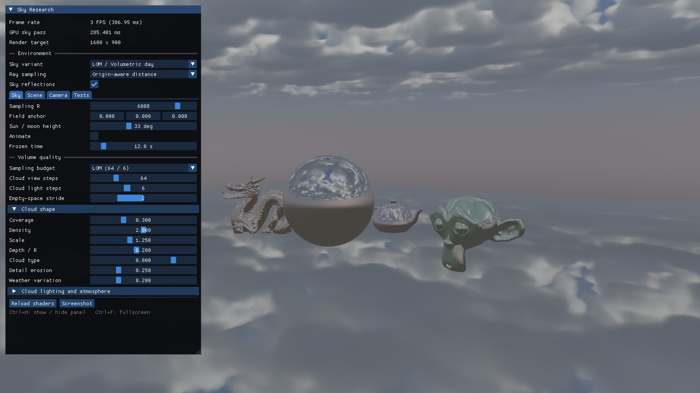
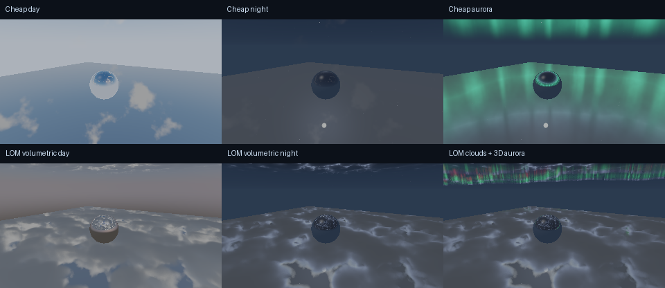

# gfx-research-sky

[](https://en.cppreference.com/w/cpp/20)
[](https://www.opengl.org/)
[](https://cmake.org/)

An experimental renderer for origin-aware sampling of spatial procedural skies and their reflections. The project compares three environment-query representations under the same sky evaluator, scene, and GPU timing harness.

The workloads range from inexpensive procedural clouds and aurora to a LOM-derived volumetric sky with view-ray integration, cloud self-shadowing, and spatial auroral curtains. Background rays and reflected rays share the same evaluator and retain their own origins.



*Application preview from software-rendered validation. The displayed timings are not target-GPU performance results.*

**Explore:** [Method](#method) · [Sky variants](#sky-variants) · [Volumetric rendering](#volumetric-rendering) · [Build](#build) · [Controls](#controls) · [Experiments](#experiments) · [References](#references)

## Highlights

- Three sampling representations with a common procedural environment interface.
- Three inexpensive sky controls, three volumetric environments, and a synthetic spatial field.
- LOM cloud projection, density profiles, erosion, cone lighting, and adaptive empty-space stepping.
- Preetham daylight distribution and separate night illumination.
- Auroral curtains integrated through a three-dimensional emissive layer behind the clouds.
- Deterministic, locally generated 3D shape and detail textures.
- Exact offscreen benchmark resolutions, raw GPU samples, HDR captures, and reconstruction ablations.
- Compact two-column controls with Sky, Scene, Camera, and Tests tabs.

## Method

Let $\mathbf{o}$ be a ray origin, $\mathbf{d}$ a unit direction, $R>0$ the sampling distance, and $\mathbf{s}_0$ the fixed field anchor. The origin-aware query is

```math
\mathbf{q}=\mathbf{o}+R\mathbf{d},\qquad
L=L_{\mathrm{env}}(\mathbf{d},\mathbf{q},\boldsymbol{\theta}).
```

The ray equation is standard. The experiment studies its use as one interface for position-dependent procedural backgrounds and rasterized sky reflections, without a captured environment map or traversal of reflected scene geometry.

| Representation | Procedural query | Role |
|---|---|---|
| Direction only | $\mathbf{s}_0+R\mathbf{d}$ | Control that removes ray-origin translation |
| Fixed world sphere | $\mathbf{o}+t_\mathrm{sphere}\mathbf{d}$ | Origin-aware finite-proxy comparator |
| Origin-aware distance | $\mathbf{o}+R\mathbf{d}$ | Direct fixed-distance query |

For the background, $\mathbf{o}$ is the camera position. For a reflection, it is the reconstructed surface position, with no normal offset. Each representation also has an explicit-world-position variant for isolating depth-reconstruction error.

For equal $R$,

```math
\Delta\mathbf{q}=\Delta\mathbf{o}+R\Delta\mathbf{d}.
```

The evaluators use normalized coordinates $\boldsymbol{\xi}=(\mathbf{q}-\mathbf{s}_0)/R$, so an equal-direction translation changes their coordinate by $\Delta\mathbf{o}/R$.

> [!NOTE]
> Different query representations need not produce visibly different images for every evaluator. The LOM planar cloud projection is invariant to moving the query along the same ray. Fixed-sphere and fixed-distance queries can consequently produce the same cloud column. This is an expected property, not evidence of a quality advantage for either representation.

## Sky variants

| ID | Environment | Evaluation |
|---|---|---|
| `day-clouds` | Cheap daytime clouds | Single-location procedural field and approximate shading |
| `night-clouds` | Cheap night clouds | Lightweight clouds, stars, and moon |
| `aurora` | Cheap aurora | Angular arcs and procedural folds |
| `world-field` | Synthetic spatial field | Deterministic bands and checker cells |
| `lom-volumetric-day` | LOM daytime sky | Analytic daylight with integrated volumetric clouds |
| `lom-volumetric-night` | LOM night sky | Moonlit volumetric clouds over a star field |
| `lom-volumetric-aurora` | LOM clouds and spatial aurora | Volume-integrated emission attenuated by foreground clouds |

The application starts with `lom-volumetric-day`. Original mode IDs remain available for comparing older inexpensive workloads.



## Volumetric rendering

### Clouds from LOM

The implementation adapts the supplied LOM `sky_common.glsl`, `sky_clouds.glsl`, `Sky.hpp`, and `SkySettings.hpp`. Its main rendering reference is **Schneider and Vos, The Real-Time Volumetric Cloudscapes of Horizon Zero Dawn (2015)**, with the related **Nubis (2017)** presentation listed below.

The projected cloud column is

```math
\mathbf{c}=k\left[\boldsymbol{\xi}_{xz}+
(h_b-\xi_y)\frac{\mathbf{d}_{xz}}{\max(d_y,0.10)}\right],
\qquad h_b=0.35.
```

Here $k$ is the cloud scale. The evaluator marches a bounded layer above the projected column. Shape noise, a height profile, weather coverage, and higher-frequency erosion determine density $\rho$. Short sunward cone samples estimate light attenuation.

View integration uses Beer-Lambert transmission and front-to-back accumulation:

```math
\tau_i=\sigma_t\rho_i\Delta s_i,\quad
T_{i+1}=T_i e^{-\tau_i},\quad
\mathbf{C}_{i+1}=\mathbf{C}_i+
T_i(1-e^{-\tau_i})\mathbf{S}_i.
```

$\mathbf{S}_i$ combines ambient light, an anisotropic phase approximation, direct-light transmission, and LOM multiple-scattering and powder approximations. Cloud radiance receives LOM's highlight shoulder and horizon fade.

| Sampling budget | Cloud view steps | Light steps per occupied sample | Aurora steps |
|---|---:|---:|---:|
| Low | 32 | 3 | 64 |
| LOM | 64 | 6 | 128 |
| High | 128 | 12 | 256 |

Default LOM parameters include coverage `0.30`, scale `1.25`, density `2.0`, depth `0.28 R`, self-shadow `1.3`, anisotropy `0.65`, multiple scattering `0.35`, and powder `0.8`. These step counts are budgets: empty-space skipping and early termination change the work actually executed.

Two periodic $128^3$ `RG8` textures provide shape and detail. Their total allocation is **8 MiB**. A compute shader generates them once, outside timed regions. This is procedural field storage, not a captured sky or reflection cache.

### Spatial aurora

The volumetric aurora follows the emissive factorization described by **Lawlor and Genetti, Interactive Volume Rendering Aurora on the GPU (2011)**:

```math
\mathbf{j}(\mathbf{p},t)=F(p_x,p_z,t)
\sum_c\mathbf{a}_c E_c(p_y),\qquad
\mathbf{L}_{a}=\int_{s_0}^{s_1}
\mathbf{j}(\mathbf{o}_{\mathrm{eff}}+s\mathbf{d},t)\,ds.
```

The two-dimensional footprint $F$ forms folded curtains. Analytic height profiles $E_c$ distribute green, violet, and red emission through their vertical extent. The effective origin is recovered from the common interface:

```math
\frac{\mathbf{o}_{\mathrm{eff}}-\mathbf{s}_0}{R}
=\frac{\mathbf{q}-\mathbf{s}_0}{R}-\mathbf{d}.
```

For the origin-aware path this is the actual origin. The shader intersects the ray with the aurora layer, integrates emission, and composites clouds in front. Curtain widths are filtered against the pixel footprint. The Gaussian curtain cross-section is integrated over each march interval, reducing missed thin features and coherent marching bands.

This is an animated spatial procedural model. It uses advected noise instead of the paper's spline/fluid data and analytic color profiles instead of atmospheric energy-deposition tables. Heights are scaled to the research scene in units of $R$. It is not a magnetohydrodynamic or spectrally calibrated simulation. Thin curtains can still show sampling bands at the Low and LOM budgets.

## Build

Requirements: **CMake 3.25+**, a **C++20** compiler, **Python 3 with Jinja2** for GLAD generation, and an **OpenGL 4.6 Core** driver. First configuration downloads dependencies through `gfx-research-base v0.3`. Windows and Linux use the same source; macOS does not provide the required OpenGL version natively.

```bash
cmake -S . -B out/build -G Ninja -DCMAKE_BUILD_TYPE=Release
cmake --build out/build --parallel
ctest --test-dir out/build --output-on-failure
```

For a local base checkout:

```bash
cmake -S . -B out/build -G Ninja -DCMAKE_BUILD_TYPE=Release -DGFX_RESEARCH_BASE_LOCAL_PATH=../gfx-research-base
cmake --build out/build --parallel
```

Launch the default scene or select a variant:

```bash
./out/build/gfx-research-sky
./out/build/gfx-research-sky --sky=lom-volumetric-aurora
```

On Windows, use `out/build/gfx-research-sky.exe`. With a multi-configuration generator, add `--config Release` when building and use its `Release` output directory.

Dragon, Suzanne, and Teapot are provided by `gfx-research-base`; this project does not duplicate them.

## Controls

Names appear on the left and full-width controls on the right, with collapsible groups for detailed settings.

| Section | Parameters |
|---|---|
| Environment | Sky variant, ray representation, object reflections |
| Sky | Field anchor, distance, time, cloud shape, lighting, atmosphere, aurora |
| Scene | Object visibility, translation, and roughness |
| Camera | Orbit distance, yaw, pitch, target, and field of view |
| Tests | Null test, spatial influence, CSV recording, and benchmark family |

`Ctrl+H` toggles the panel. `Ctrl+F` toggles fullscreen. The panel can be resized and scrolled. During a benchmark, experiment controls are locked; the stop button remains active.

## Experiments

### Run a suite

```bash
./out/build/gfx-research-sky --publication-smoke --publication-output=results/smoke
./out/build/gfx-research-sky --publication-quick --publication-output=results/quick
./out/build/gfx-research-sky --publication-suite --publication-output=results/release
```

| Profile | Purpose | Resolution | Main timing protocol |
|---|---|---|---|
| Smoke | Application, budget, null, and reconstruction checks | 320 × 180 | 8 warm-up frames, 4 timestamp samples |
| Quick | Development checks | 1920 × 1080 | 30 warm-up frames, 120 samples, 2 repeats |
| Full | New publication data | 1080p, 1440p, 4K | 120 warm-up frames, 600 samples, 10 repeats |

The full profile covers both workload families, all three representations, reflections on/off, camera and object translation, distance sweeps, explicit-position ablations, and null tests. Additional volumetric sweeps measure Low, LOM, and High budgets at 1080p. The synthetic field remains a separate geometric diagnostic.

Main volumetric timing cases use `R = 6000`, matching the supplied LOM default. Translation and reconstruction experiments also use smaller distances to expose spatial differences. The suite resets editable scene parameters and freezes procedural time at `12 s`.

Filter the workload family or run only invariant checks:

```bash
./out/build/gfx-research-sky --publication-suite --publication-family=volumetric --publication-output=results/volume
./out/build/gfx-research-sky --publication-quick --publication-family=cheap --publication-output=results/cheap
./out/build/gfx-research-sky --publication-null-only --publication-output=results/null
```

`--publication-family` accepts `all`, `cheap`, or `volumetric`. Triplets rotate method order between repeats. Only newly resolved timestamp results are counted; stale values are not repeated when a costly frame delays the GPU.

### Analyze results

```bash
python -m pip install "numpy>=1.26" "Pillow>=10"
python tools/analyze_publication.py results/release
```

For display-space SSIM, also install `scikit-image` before running the analyzer.

| File | Contents |
|---|---|
| `manifest.txt` | GPU/driver strings, field settings, noise configuration, completion status |
| `raw.csv` | Individual GPU samples with workload and integration budgets |
| `summary.csv` | Timing statistics and geometric diagnostics |
| `quality.csv` | Representation differences and per-representation reconstruction errors |
| `null.csv` | Exact HDR and display-image equality checks |
| `captures.csv`, `hdr/*.pfm` | Capture index and linear HDR images |
| `timing_aggregate.csv` | Paired timing deltas and bootstrap intervals, separated by workload and budget |
| `reflection_toggle_aggregate.csv` | Reflections on/off cost differences |

The explicit-position image is a reconstruction reference, not a converged light-transport reference. Reflections use a single reflected query with a roughness-dependent blend rather than a filtered specular integral.

> [!IMPORTANT]
> This revision adds workloads and measurement coverage. It does not supply a new target-GPU publication run. Older timings do not measure these volumetric cases. Run the full Release suite before revising numerical claims in a manuscript.

### Verify without the interactive application

CPU references can be built without downloading the base project:

```bash
cmake -S . -B out/tests -DGFX_RESEARCH_BUILD_APP=OFF
cmake --build out/tests
ctest --test-dir out/tests --output-on-failure
```

Optional shader checks compile and execute the actual rendering and compute shaders in a standalone context:

```bash
python -m pip install "numpy>=1.26" "Pillow>=10" "moderngl>=5.12,<6" "glcontext>=3,<4"
python tools/validate_gpu.py --backend=egl --output=results/gpu-validation
```

The shader checks use a plane and a sphere to exercise all seven skies, null equivalence, repeatability, cloud coverage, aurora emission, and sampling budgets. On Mesa llvmpipe (LLVM 19.1.7), all 33 checks passed. The maximum absolute error of the local Gaussian curtain integral against its double-precision reference was `1.16e-6`.

The Release application smoke run with GCC 14.2 completed 138 cases at 320 × 180. All six null comparisons produced byte-identical HDR and display images. This run used GLFW's headless OSMesa path and measured correctness on a software renderer. Both CPU reference tests passed.

## Project structure

| Location | Responsibility |
|---|---|
| `src/main.cpp` | Scene, sampling methods, benchmark cases, and result collection |
| `src/sky_gui.inl` | Parameter panel and uniform binding |
| `src/volume_settings.hpp` | LOM defaults and sampling budgets |
| `src/cloud_noise.hpp` | One-time 3D field generation |
| `src/atmosphere.hpp` | Frame-constant Preetham parameters |
| `src/experiment_gpu_timer.hpp` | Asynchronous timestamp collection |
| `shaders/sky.frag` | Shared ray queries, cheap skies, and compositing |
| `shaders/volume.glsl` | LOM clouds, daylight, and spatial aurora |
| `shaders/cloud_noise.comp` | Periodic shape/detail fields |
| `tests/` | Independent geometry and transport checks |
| `tools/` | Analysis, image comparison, optional shader validation |

Differences from LOM and the papers are described in [IMPLEMENTATION.md](docs/IMPLEMENTATION.md).

## References

1. **Schneider, Andrew; Vos, Nathan.** [The Real-Time Volumetric Cloudscapes of Horizon Zero Dawn](https://www.guerrilla-games.com/read/the-real-time-volumetric-cloudscapes-of-horizon-zero-dawn). SIGGRAPH 2015, Advances in Real-Time Rendering in Games. Main cloud reference used by LOM.
2. **Schneider, Andrew; Vos, Nathan.** [Nubis: Authoring Real-Time Volumetric Cloudscapes with the Decima Engine](https://www.guerrilla-games.com/read/nubis-authoring-real-time-volumetric-cloudscapes-with-the-decima-engine). SIGGRAPH 2017, Advances in Real-Time Rendering in Games. Noise, weather, and production context.
3. **Lawlor, Orion Sky; Genetti, Jon.** [Interactive Volume Rendering Aurora on the GPU](https://lawlor.cs.uaf.edu/~olawlor/papers/2010/aurora/lawlor_aurora_2010.pdf). Journal of WSCG **19**, 1-3 (2011), pp. 25-32. Spatial emissive-layer factorization and ray integration. The PDF directory is named `2010`; journal publication is from **2011**.
4. **Preetham, A. J.; Shirley, Peter; Smits, Brian.** [A Practical Analytic Model for Daylight](https://doi.org/10.1145/311535.311545). SIGGRAPH 1999, pp. 91-100. Daylight distribution and zenith chromaticities.

The LOM adaptation uses the user's supplied source. This project is not an official implementation or a redistribution of Guerrilla's game assets.
